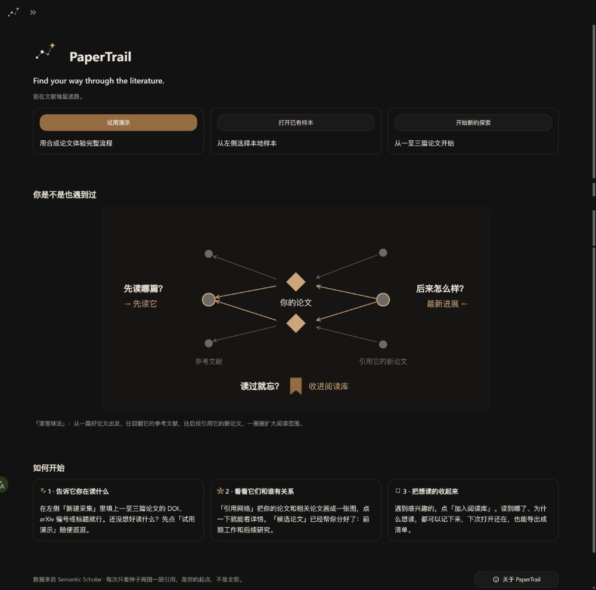
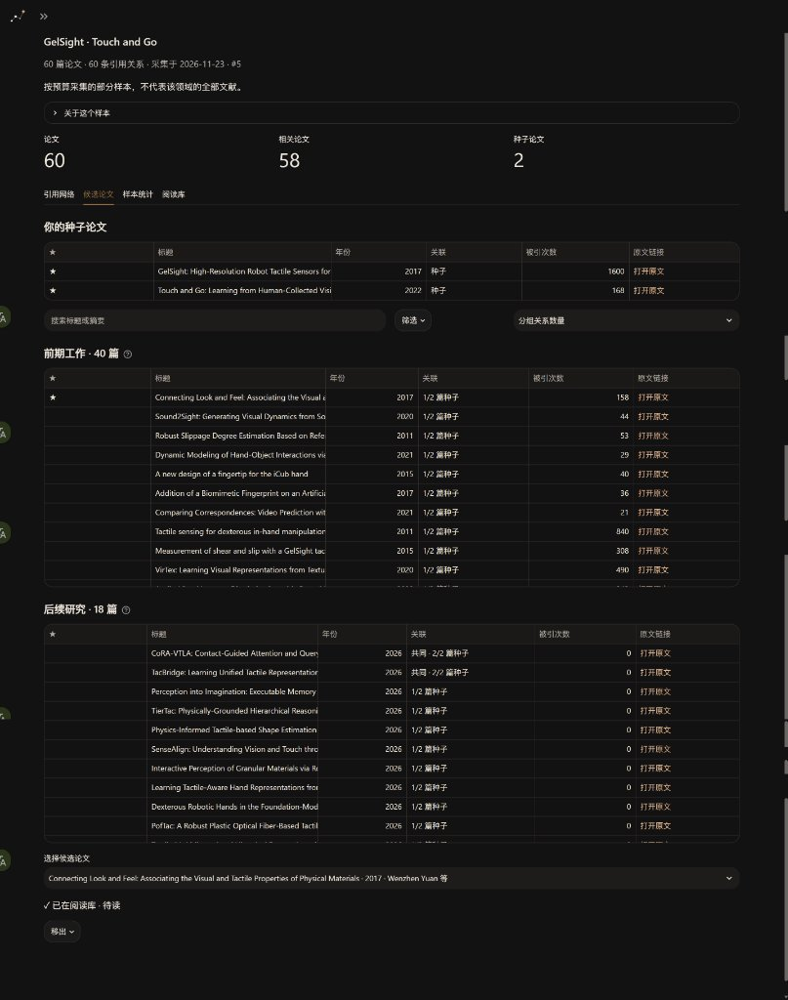

# PaperTrail

**Find your way through the literature.** · 别在文献堆里迷路。

PaperTrail 是一个基于 Python 的科研文献引用关系分析与可视化工具。从手头的 **1–3 篇种子论文** 出发，沿着 [Semantic Scholar Academic Graph API](https://api.semanticscholar.org/api-docs/graphs) 进行有限、可追溯的单层（one-hop）引用扩展，生成可点击的**有向引用网络**、按方向分组的**可解释候选清单**、**样本统计**以及独立持久化的**个人阅读库**。



---

## 核心特性

- **1–3 篇种子论文导入：** 支持 DOI、arXiv ID、Semantic Scholar ID 及论文标题检索；标题搜索返回最多 5 篇候选并强制人工核对确认，不自动误匹配。
- **受控单层扩展与本地缓存：** 参考文献全取（单种子默认上限 10,000），被引论文按全局预算均分（默认 150）；内置请求配额控制、限流退避与 7 天 SQLite 缓存续传。
- **有向引用网络可视化：** 统一 `citing -> cited` 边方向（箭头 $A \to B$ 表示 $A$ 引用了 $B$）；支持节点悬停、点击联动详情卡片、原文安全外链与可调显示上限。
- **分组候选与可解释排序：** 种子独立展示，非种子候选分为**「前期工作」**（种子引用的参考文献）和**「后续研究」**（引用种子的论文）两组；明确标注 `共同 · k/n 篇种子`，严格区分样本内关联与外部全局被引次数，且缺失值 `None` 不当作 `0`。
- **样本统计与透明覆盖：** 统计筛选前全样本的逐年分布、多关键词标题/摘要/并集去重命中数与 7 项元数据完整度；显式展示配额截断方向与警告。
- **独立持久化个人阅读库：** 跨样本收藏并即时编辑阅读状态（待读/在读/已读）、优先级与备注，独立保存在 `output/library.db` 中确保样本库永久只读；支持导出 UTF-8 BOM 防公式注入 CSV 与防注入 Markdown。
- **零网络离线演示与双入口：** 内置合成演示数据集一键体验；同时提供 Streamlit 图形界面与命令行工具（CLI）。



---

## PaperTrail 不做什么

- 不替代完整文献搜索引擎，不用有限单层采样冒充全领域覆盖或趋势。
- 不自动评判“经典论文”“必读 baseline”或学术价值，所有排序仅作为可检查的阅读依据。
- 不做 PDF 全文抓取、LLM 自动综述、无限多轮滚雪球扩展或云端多用户账户同步。

---

## 快速开始

### 1. 环境安装（Windows / Python 3.11+）

在仓库根目录使用 PowerShell 执行（无需激活虚拟环境或修改执行策略）：

```powershell
python --version
python -m venv .venv
.\.venv\Scripts\python.exe -m pip install -r requirements.txt
```

核心依赖精简：仅依赖 `requests`、`networkx`、`streamlit`、`plotly`（测试依赖 `pytest`），数据库使用 Python 内置 `sqlite3`。

### 2. 启动图形界面与离线演示

```powershell
.\.venv\Scripts\python.exe -B -m streamlit run streamlit_app.py
```

在浏览器打开 `http://127.0.0.1:8501`（默认仅监听本机，已关闭统计上传）。点击首页 **「试用演示」** 即可零网络、零 API Key 体验完整流程。

> 更新代码后请在运行服务的终端按 `Ctrl + C` 重启，再刷新浏览器。详细界面操作见 **[软件使用说明书](docs/USER_MANUAL.md)**。

### 3. 配置 Semantic Scholar API Key（仅联网采集需要）

离线演示与打开已有本地样本均**无需联网、无需 Key**。如需使用「新建采集」，请先在 [Semantic Scholar API 门户](https://www.semanticscholar.org/product/api#api-key-form) 申请 Key，再写入当前用户的环境变量（输入时自动隐藏）：

```powershell
$s = Read-Host '粘贴 S2 API Key' -AsSecureString; [Environment]::SetEnvironmentVariable('SEMANTIC_SCHOLAR_API_KEY', [Runtime.InteropServices.Marshal]::PtrToStringBSTR([Runtime.InteropServices.Marshal]::SecureStringToBSTR($s)).Trim(), 'User'); Remove-Variable s
```

设置完成后请**关闭并重新打开所有终端窗口**。程序仅从 `SEMANTIC_SCHOLAR_API_KEY` 环境变量读取密钥，绝不写入日志或代码。Semantic Scholar 规定 Key 闲置约 60 天可能被静默移除（表现为全员 HTTP 429）。

---

## 命令行工具（CLI）

所有分析命令均为严格只读且不联网；仅 `collect.py` 的在线模式发起 API 请求：

```powershell
# 联网采集（2 篇种子，全局被引预算 150，参考文献上限 10000，最多 30 次 HTTP 尝试）
.\.venv\Scripts\python.exe -B scripts/collect.py DOI:10.3390/s17122762 ARXIV:2211.12498 --db output/my-sample.db --citation-budget 150 --reference-cap 10000 --page-size 100 --request-budget 30

# 使用内置离线夹具采集演示库（不联网）
.\.venv\Scripts\python.exe -B scripts/collect.py ARXIV:0000.00001 ARXIV:0000.00002 --offline-fixture tests/fixtures/s2_collection.json --db output/demo.db --page-size 2

# 只读查看已保存样本概况
.\.venv\Scripts\python.exe -B scripts/collect.py --db output/my-sample.db --show-run 1

# 只读有向图分析（支持 --json）
.\.venv\Scripts\python.exe -B scripts/analyze.py --db output/my-sample.db --run-id 1

# 候选发现、筛选与统计（默认按被种子引用数排序；看后续研究可指定 --sort-by cites_seed_count）
.\.venv\Scripts\python.exe -B scripts/discover.py --db output/my-sample.db --run-id 1 --sort-by cites_seed_count --top 20
```

---

## 项目架构

项目按单向依赖严格分离采集、存储、分析与展示层：

```text
PaperTrail/
├── streamlit_app.py              # Streamlit 启动入口
├── src/papertrail/
│   ├── api.py                    # Semantic Scholar HTTP 客户端、RequestBudget、重试退避与脱敏
│   ├── collector.py              # 1–3 篇种子单层分页采集、配额均分与 7 天缓存续传
│   ├── store.py                  # SQLite 样本库、run_items 归属隔离与 ?mode=ro 只读快照
│   ├── analysis.py               # 只读加载与严格校验，构建 NetworkX 有向图（citing -> cited）
│   ├── discovery.py              # 双类别候选发现、AND/OR 组合筛选、并列排名与全样本统计
│   ├── library.py                # 独立个人阅读库（output/library.db，与演示库严格隔离）
│   ├── ui_service.py             # 防重复提交状态机、批量 Plotly 构图缓存与安全导出转义
│   ├── ui.py / ui_library.py     # Streamlit 交互界面与个人阅读库面板
│   └── cli.py / analysis_cli.py / discovery_cli.py
├── scripts/                      # collect.py / analyze.py / discover.py / benchmark_ui_graph.py
├── tests/                        # 7 个测试模块（396 项纯离线自动化测试）与离线夹具
└── docs/USER_MANUAL.md           # 完整图形界面与 CLI 使用手册
```

---

## 离线测试与性能基准

所有自动化测试使用离线夹具与 HTTP Mock，不访问外网、不消耗配额：

```powershell
$env:PYTHONDONTWRITEBYTECODE="1"
.\.venv\Scripts\python.exe -m pytest -q -p no:cacheprovider
```

- **实测结果（Python 3.11.7）：** `396 passed`（覆盖 API 编码/重试/脱敏、采集分页/缓存、SQLite `?mode=ro` 只读隔离、NetworkX 有向图校验、并列与 `None != 0` 排序、Streamlit `AppTest` 状态机、个人阅读库及防注入导出）。
- **构图性能基准（`scripts/benchmark_ui_graph.py`）：** 通过批量构建 Plotly `annotations`/`shapes` 与单视图缓存，100 节点（293 边）构图中位耗时由 `27.55s` 降至 **`0.088s`（314×）**，200 节点（593 边）由 `119.67s` 降至 **`0.277s`（431×）**。

---

## 数据局限与声明

- **单层星型偏差：** 仅扩展种子周围一层，候选论文之间的引用边大多未采集；局部度数不能直接等同于学术影响力。
- **截断与时间偏向：** `citations` 接口按从新到旧返回，按预算截断（`bounded`）的样本偏向近期论文（可能包含期刊 online-first 的次年年份）；按 API 返回顺序截断不代表“最重要的 N 篇”。
- **外部接口限流：** Semantic Scholar 免费接口在高峰期可能间歇性返回 HTTP 429；系统采用 2.0 秒最小间隔、有界重试与 7 天本地缓存续传，并在报告中记录 `attempt_status_counts`。
- **数据来源与许可：** 文献元数据来自 [Semantic Scholar Academic Graph API](https://www.semanticscholar.org/product/api)，使用与再分发须遵守其官方条款；本仓库不提交个人 API Key、本地数据库或真实原始 API 响应。

## 相关文档

- **[软件使用说明书（完整图文指南）](docs/USER_MANUAL.md)**
- **[项目范围与设计规格](docs/PROJECT_BRIEF.md)**
