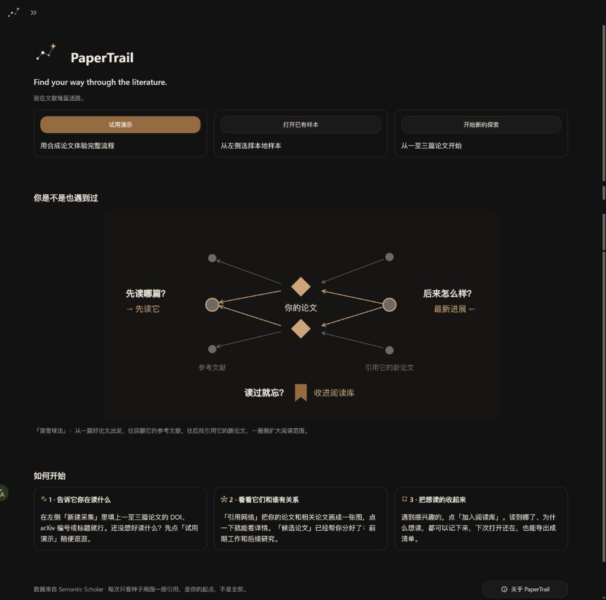
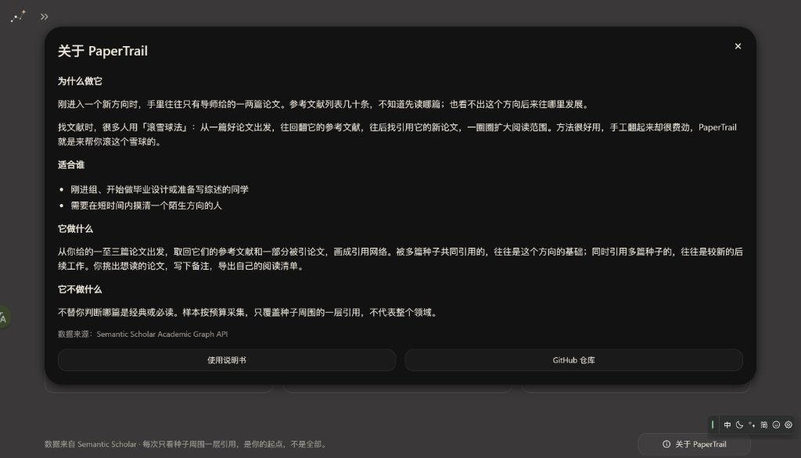
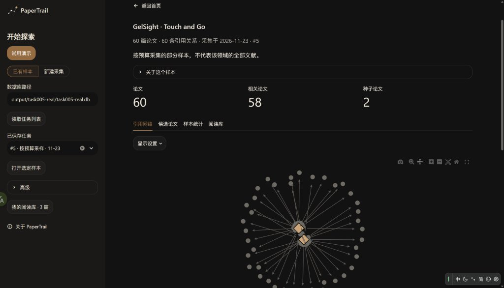
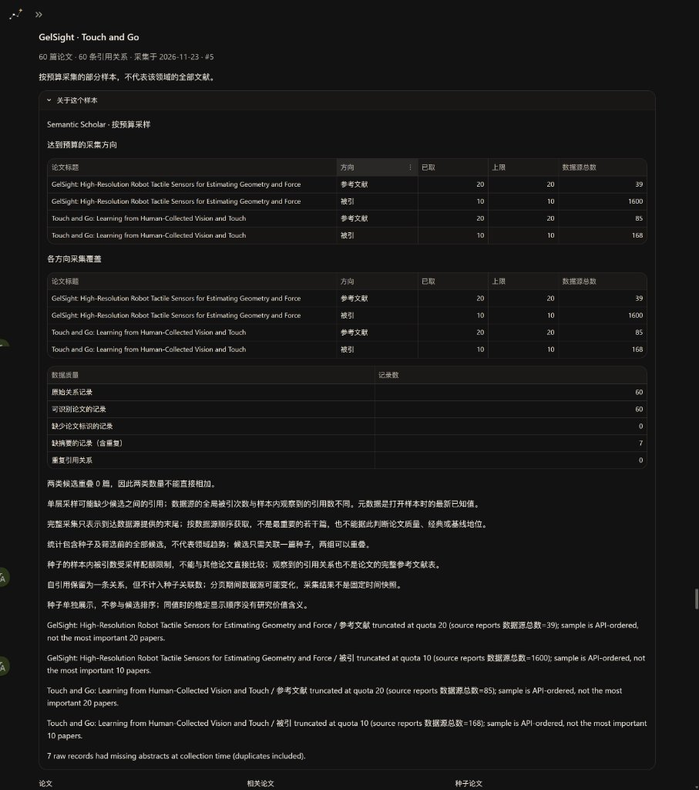
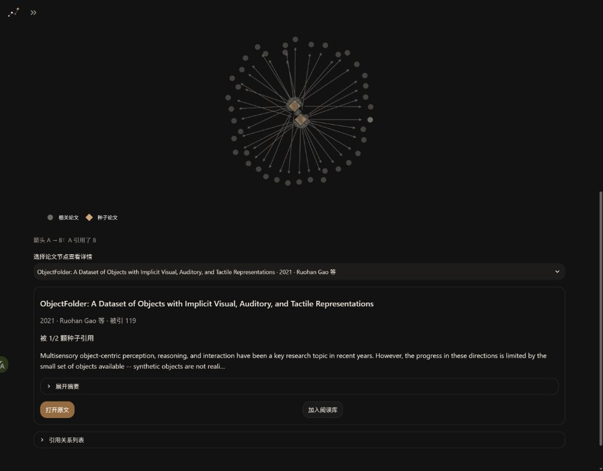
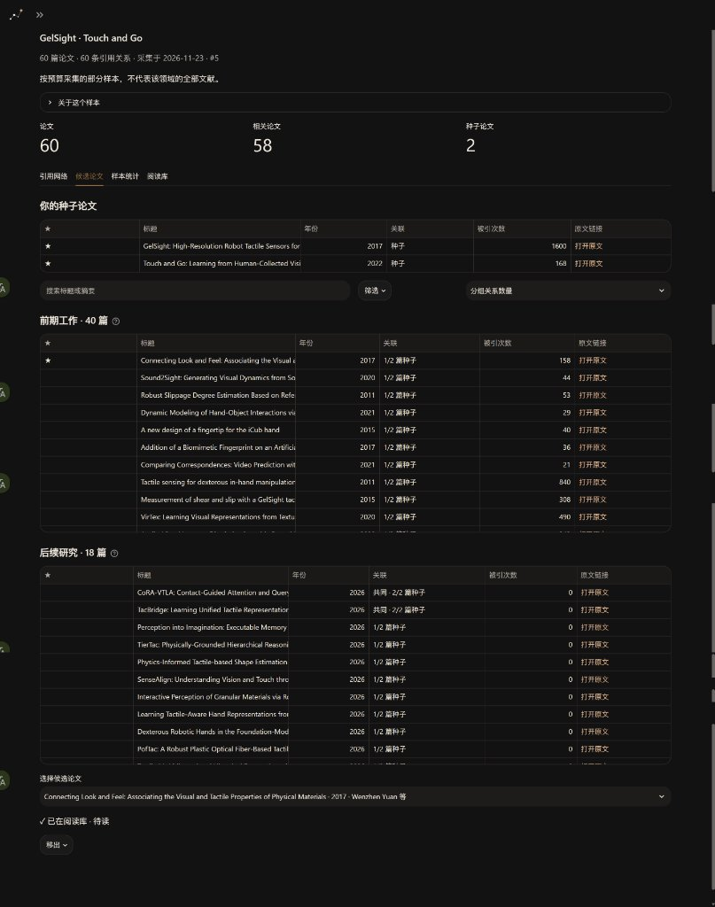
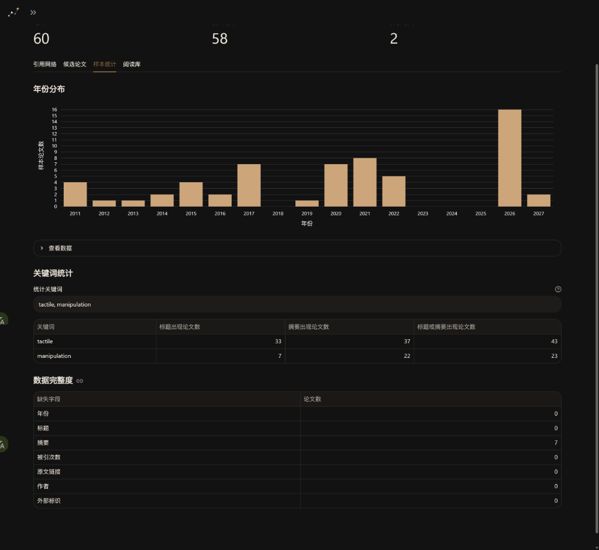
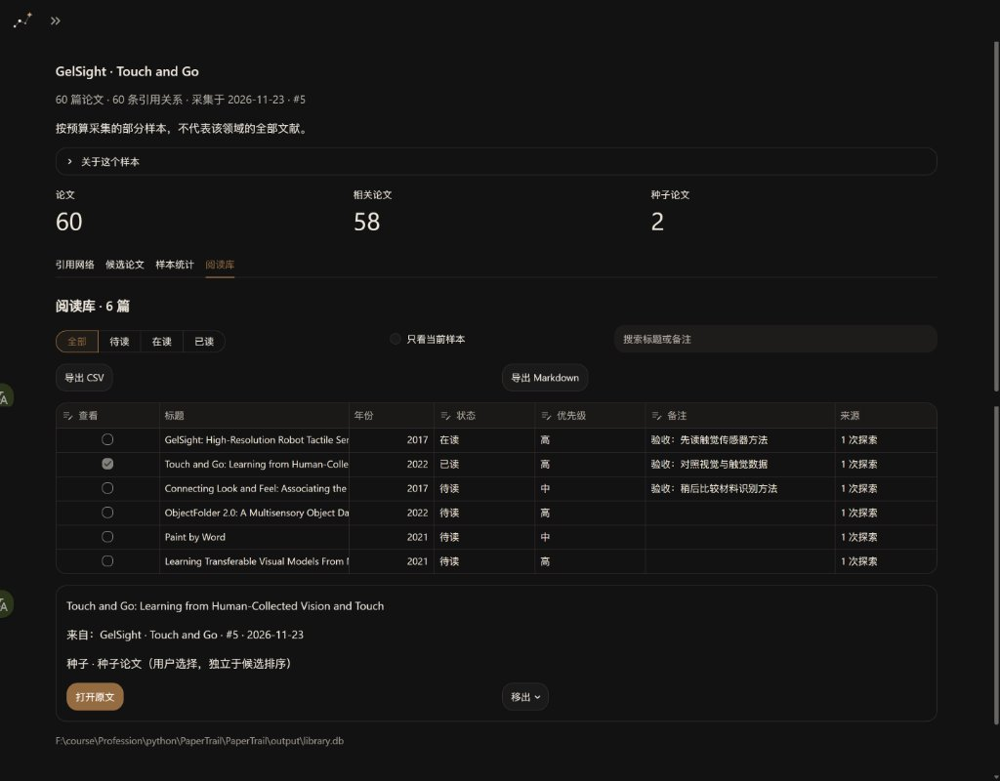
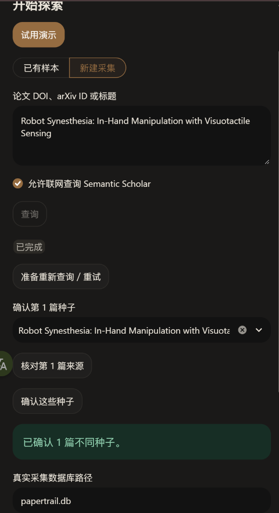

# PaperTrail 软件使用说明书

**软件名称：** PaperTrail：基于 Python 的科研文献引用关系分析与可视化系统
**版本：** v0.1（2026-11）
**适用平台：** Windows 10/11，Python 3.11 及以上

---

## 1. 软件简介

PaperTrail 帮助刚进入某个研究领域的初学者，从手头的 **1–3 篇"种子论文"** 出发，沿着引用关系收集一个**有限、可追溯**的文献样本，并提供：

- **有向引用网络**：箭头 A → B 表示"论文 A 引用了论文 B"，可以点击节点查看论文详情。
- **候选论文**：把与种子有引用关系的论文分成"前期工作"和"后续研究"两组，每篇都写明和几篇种子有关系（例如"共同 · 2/2 篇种子"）。
- **样本统计**：已采集样本的逐年篇数、关键词出现次数、缺失字段情况。
- **阅读库与导出**：收藏想读的论文，记录阅读状态、优先级和备注；关闭软件后仍会保留，可导出 CSV 和 Markdown 阅读清单。

**PaperTrail 不做什么：** 它不是搜索引擎，也不会自动判断哪篇是"经典论文"或"必读论文"。所有排序都只是**可检查的依据**，由使用者自己决定读什么。

数据来源是 [Semantic Scholar Academic Graph API](https://www.semanticscholar.org/product/api)。

---

## 2. 安装

在 PowerShell 中进入项目根目录（含 `README.md` 的文件夹），依次执行：

```powershell
python --version
python -m venv .venv
.\.venv\Scripts\python.exe -m pip install -r requirements.txt
```

- 第一条命令显示的版本必须是 **3.11 或更高**。如果版本较旧，请用已安装的 3.11+ 解释器的完整路径代替 `python`。
- 之后的所有命令都直接使用 `.\.venv\Scripts\python.exe`，**不需要激活虚拟环境**，也不需要修改 PowerShell 执行策略。
- 主要依赖：requests、NetworkX、Streamlit、Plotly、pytest。

---

## 3. 配置 API Key（只在联网采集时需要）

**离线演示和打开已有样本都不需要 Key。** 只有"新建采集"会联网。

1. 在 Semantic Scholar 的 [API 申请页](https://www.semanticscholar.org/product/api#api-key-form) 申请 Key，Key 会通过邮件发送。
2. 在 PowerShell 中运行下面的命令，按提示粘贴 Key。输入时不显示，也不会留在命令历史里：

   ```powershell
   $s = Read-Host '粘贴 S2 API Key' -AsSecureString; [Environment]::SetEnvironmentVariable('SEMANTIC_SCHOLAR_API_KEY', [Runtime.InteropServices.Marshal]::PtrToStringBSTR([Runtime.InteropServices.Marshal]::SecureStringToBSTR($s)).Trim(), 'User'); Remove-Variable s
   ```

3. **关闭所有 PowerShell 窗口后重新打开**，新设置的环境变量才会生效。如果用的是 Windows Terminal，要把整个程序关掉再打开。

> ⚠️ **注意：**
> - 程序只从环境变量 `SEMANTIC_SCHOLAR_API_KEY` 读取 Key，不读取 `.env` 文件，也不会在界面或日志中显示 Key。
> - **不要**把 Key 写进代码、聊天记录或 Git 提交。
> - Semantic Scholar 规定：**Key 大约 60 天不使用就可能被移除**。被移除的 Key 不会报"无效"，而是每个请求都返回 429。建议至少每 1–2 个月用一次。

---

## 4. 启动图形界面

```powershell
.\.venv\Scripts\python.exe -m streamlit run streamlit_app.py
```

然后在浏览器中打开 **http://127.0.0.1:8501**。

- 运行 Streamlit 的终端窗口**必须一直开着**，关掉它界面就停止了。
- 结束使用时，在该终端里按 **Ctrl + C**。
- 更新代码后，需要按 Ctrl + C 停止再重新启动，只刷新网页不一定会加载新代码。

### 首页



启动后先看到首页，从上到下依次是：

- **标题与标语**："Find your way through the literature."，下方小字"别在文献堆里迷路。"
- **三个入口**：
  - **「试用演示」**：用合成论文体验完整流程，不联网（见第 5 节）。
  - **「打开已有样本」**：在左侧栏切换到"已有样本"，打开本地数据库（见第 6 节）。
  - **「开始新的探索」**：在左侧栏切换到"新建采集"，从一至三篇论文开始联网采集（见第 11 节）。
- **"你是不是也遇到过"**：一张示意图，说明 PaperTrail 帮你做的是文献检索中的"滚雪球法"——从一篇论文出发，往回翻参考文献，往后找引用它的新论文。
- **"如何开始"**：三步卡片，分别对应"输入论文 → 查看引用关系 → 收进阅读库"。
- **「关于 PaperTrail」**（页面底部和左侧栏都有）：弹出说明窗口，介绍为什么做这个软件、适合谁、它做什么和不做什么、数据来源，并提供本说明书和 GitHub 仓库的链接。



左侧栏始终显示 **「试用演示」**、数据入口（"已有样本 / 新建采集"）、**「我的阅读库 · N 篇」** 和 **「关于 PaperTrail」**。打开样本后，点击页面左上角的 **「返回首页」** 可以回到首页；样本和阅读库文件不受影响。

---

## 5. 快速上手：离线演示（无需网络、无需 Key）

点击首页或左侧栏的 **「试用演示」**。程序会用内置的合成数据（`tests/fixtures/s2_collection.json`）建立一个演示样本：4 篇论文、5 条引用关系、2 篇种子。

样本标题旁会显示灰色的 **「演示数据」** 标记；展开「关于这个样本」可以看到完整说明"所有论文与引用量均为合成内容，不是真实研究成果"。演示论文没有原文链接，不会把虚构的 DOI 变成真实链接。演示时收藏的论文保存在独立的演示阅读库里，不会混进真实阅读库。

演示适合第一次熟悉界面，以及在离线或无网络环境下快速展示完整流程。

---

## 6. 打开已有样本

已经采集过的数据保存在 SQLite 数据库里。打开样本**不会联网**。

1. 点击首页的 **「打开已有样本」**，或在左侧栏的数据入口中选择 **已有样本**。
2. 在 **「数据库路径」** 中输入数据库文件路径，例如 `output/task005-real/task005-real.db`。相对路径从项目根目录算起。
3. 点击 **「读取任务列表」**，在 **「已保存任务」** 中选择一个任务，例如 `#5 · 按预算采样 · 11-23`（编号 · 状态 · 采集日期），再点击 **「打开选定样本」**。
   如果已经知道编号，也可以展开 **「高级」**，在「样本编号」中输入编号，点击 **「按编号打开」**。

> 只有状态为"完整采集"（`ok`）或"按预算采样"（`bounded`，达到设定配额的正常截断）的样本才能打开分析。"未完成"（`incomplete`，例如被限流中断）的样本会报错，不会被当作有效结果显示。

打开后，页面顶部显示样本概况：



| 区域 | 含义 |
|---|---|
| 「返回首页」 | 关闭当前样本，回到首页 |
| 标题行 | 种子论文的标题（只取冒号前的部分）；演示样本旁有「演示数据」标记 |
| 灰色说明行 | 样本论文数 · 引用关系数 · 采集日期 · 样本编号（如 `#5`） |
| 提示语 | "按预算采集的部分样本，不代表该领域的全部文献。" |
| 「关于这个样本」 | 折叠区，内容见下表 |
| 数字卡片 | **论文**（样本总数）、**相关论文**（非种子候选数）、**种子论文** |

展开 **「关于这个样本」** 可以看到：



| 内容 | 含义 |
|---|---|
| 数据源 · 状态 | 例如 `Semantic Scholar · 按预算采样` |
| 达到预算的采集方向 | 哪些种子的哪个方向（参考文献 / 被引）达到了配额 |
| 各方向采集覆盖 | 每篇种子每个方向的"已取"、"上限"和"数据源总数" |
| 数据质量 | 原始关系记录、可识别论文的记录、缺少论文标识的记录、缺摘要的记录、重复引用关系 |
| 方法局限 | 两类候选的重叠数、单层采样的局限、排序不代表研究价值等说明 |
| 警告 | 采集过程中记录的警告（论文 ID 已替换为标题） |

下面依次介绍四个标签页：引用网络、候选论文、样本统计、阅读库。

---

## 7. 引用网络



- **金色菱形**是种子论文，**灰色圆点**是其他相关论文。**箭头 A → B 表示 A 引用了 B**（图下方也有这句提示）。
- 鼠标悬停在节点上可以看到论文标题；**点击节点**，或在 **「选择论文节点查看详情」** 下拉框中选择，下方会显示详情卡片：
  - 标题；年份 · 第一作者 · 被引次数（数据源的全局被引次数）；
  - 与种子的关系，例如"共同：被 2/2 颗种子引用"；
  - 摘要前 240 字，较长时可点「展开摘要」看全文；
  - **「打开原文」**：打开论文的 DOI 或 arXiv 页面；
  - **「加入阅读库」**：收藏这篇论文（见第 10 节）。已收藏的论文显示"✓ 已在阅读库"和阅读状态。
- 选中一个节点后，其他节点会稍微变暗，便于看清当前论文。
- 图右上角的 **「显示设置」** 里可以调整 **「网络显示节点上限」**（3–200）。它只影响画图时显示多少个节点（优先显示种子），不会改变样本、候选或统计结果。
- 展开 **「引用关系列表」** 可以看到当前显示的每条引用关系（引用者 → 被引用者）。

> 网络图上看到的是**样本中**的引用关系，和**数据源的全局被引次数**是两个不同的指标。单层采样得到的网络通常呈"以种子为中心的星型"，候选论文之间的相互引用多半没有采到。

---

## 8. 候选论文



页面最上方是 **「你的种子论文」**，单独列出，不参与候选排序。下面的候选论文按与种子的关系分成两组：

| 分组 | 含义 | 典型用途 |
|---|---|---|
| **前期工作** | 种子论文引用了它们（种子的参考文献） | 找**基础方法、前人工作** |
| **后续研究** | 它们引用了种子论文 | 找**后续发展、最新研究** |

一篇论文可能同时出现在两组中，所以两组数量不能直接相加。

- 表格各列：★（已在阅读库）、标题、年份、**关联**、被引次数、原文链接（点「打开原文」）。
- **「关联」** 一栏写明这篇论文和几篇种子有关系。例如"**共同 · 2/2 篇种子**"表示它和两篇种子都有关系，通常值得优先看。只有关联到至少 2 篇种子时才会标"共同"。
- **搜索框**（"搜索标题或摘要"）：输入关键词，多个词用逗号分隔，标题或摘要中必须**全部命中**。
- **「筛选」**：可以勾选「启用年份筛选」（最早 / 最晚年份）和「启用被引次数筛选」（最少 / 最多引用量）。启用数值筛选时，缺少该字段的论文会被排除。
- **排序**：默认是"分组关系数量"，每组按各自的关联种子数降序排列；也可以改为按"被多少颗种子引用""引用多少颗种子""来源全局引用量"或"年份"降序排列。数值相同的论文按固定顺序排列，**这个顺序没有任何研究意义**；缺少该字段的论文排在最后。
- 表格下方的 **「选择候选论文」** 选中一篇后，可以直接点 **「加入阅读库」**。

---

## 9. 样本统计



- **年份分布**：柱状图显示**当前样本**（含种子）逐年的论文数，不代表整个研究领域的趋势。展开 **「查看数据」** 可以看到对应的表格。
- **关键词统计**：输入逗号分隔的词，分别统计标题、摘要、"标题或摘要"中出现该词的论文数。不区分大小写，按字面匹配，每篇论文只计一次；"标题或摘要"是去重后的并集，不是前两列相加。统计针对全部样本，不受候选论文页筛选的影响。
- **数据完整度**：年份、标题、摘要、被引次数、原文链接、作者、外部标识各有多少篇论文缺失。
- 采集覆盖、警告和方法局限统一放在样本概况的 **「关于这个样本」** 中（见第 6 节）。

---

## 10. 阅读库与导出



1. 在引用网络的详情卡片或候选论文页选择论文，点击 **「加入阅读库」**。已收藏的论文显示 ★ 和阅读状态。
2. 打开 **「阅读库」** 标签页，在表格中直接修改 **状态（待读 / 在读 / 已读）**、**优先级（高 / 中 / 低，可清空）** 和 **备注（最多 2000 字）**。编辑后按 Enter 或点击其他单元格，修改会立即保存，无需另点保存。
3. 用状态按钮、**「只看当前样本」** 和标题/备注搜索筛选。CSV 和 Markdown 只导出当前筛选结果，文件名为 `papertrail-library.csv` 和 `papertrail-library.md`。
4. 勾选某行的 **「查看」**，下方显示发现来源、日期、关系说明，以及原文和移出按钮。点击「移出」会先展开确认框，只有点击「确认移出」才删除；关闭确认框不会修改数据。移出会同时删除这篇论文在阅读库中的备注、状态和来源记录，不影响样本。
5. 不打开样本也能点击左侧栏的 **「我的阅读库 · N 篇」** 进入真实阅读库，点击左上角的「返回首页」（已打开样本时为「返回样本」）离开。关闭浏览器或重启 Streamlit 后，收藏、状态、优先级和备注仍会恢复。

同一篇论文跨样本共享备注和状态。再次遇到已收藏论文时，可点击 **「记录本次探索」** 追加来源并更新元数据；不会覆盖个人字段。

导出字段为标题、年份、来源链接、状态、优先级、备注、发现于、关系说明、paperId。Markdown 保留采样局限，并列出涉及的截断样本及采集范围（样本路径只显示文件名）；离线快照使导出不依赖原样本文件。
CSV 使用 UTF-8 BOM 并转义公式，Markdown 将外部文本作为字面内容。只有校验通过的 HTTP(S) 原文地址生成链接；演示数据没有真实论文链接。

真实阅读库固定保存在 **`output/library.db`**，演示阅读库单独保存在 **`output/ui-demo/library-demo.db`**。页面底部显示文件位置；退出 Streamlit 后复制对应文件即可备份。所有阅读库操作均不联网，也不会写入样本数据库。

---

## 11. 新建采集（联网）



1. 点击首页的 **「开始新的探索」**，或在左侧栏的数据入口中选择 **新建采集**。
2. 在 **「论文 DOI、arXiv ID 或标题」** 中**每行输入一篇**，共 1–3 篇。支持以下格式：
   - DOI：`10.3390/s17122762`、`DOI:10.3390/s17122762` 或 DOI 网址
   - arXiv：`2211.12498`、`ARXIV:2211.12498` 或 arXiv `/abs/` 网址
   - 论文标题：例如 `Robot Synesthesia: In-Hand Manipulation with Visuotactile Sensing`
3. 勾选 **「允许联网查询 Semantic Scholar」**，点击 **「查询」**。
   - 输入标题时，会返回最多 5 篇候选论文，**不会自动采用第一条**，需要自己选择。
   - 标题中的连字符只在发请求时替换为空格，输入框里的原文不变。
4. 在「确认第 N 篇种子」中选择正确的论文。可以点 **「核对第 N 篇来源」** 打开论文页面确认，然后点击 **「确认这些种子」**，看到"已确认 N 篇不同种子"即可。
5. 设置 **「真实采集数据库路径」**（**建议与演示库分开**，例如 `output/my-sample.db`）。需要时展开 **「高级设置」** 调整「全局被引记录预算」（默认 150，平均分给各种子）和「最大请求尝试次数（含重试）」（默认 100）。然后点击 **「开始采集」**。
6. 采集结果为"完整采集"或"按预算采样"时，会**自动打开新样本**；如果未完成，页面会提示"采集未完成，无法分析"，已取得的部分会保留在缓存中，可以稍后重试。展开 **「技术详情」** 可以查看完整的采集报告。

**说明：**
- 每篇种子的参考文献最多读取 10000 条（相当于全部读取），被引论文按预算截断。只扩展一层。
- 再次采集相同的种子时，7 天内的数据会直接使用缓存，不重复请求。
- 同一组参数只提交一次。要重试，先点「准备重新查询／重试」或「准备重新采集／重试」。

---

## 12. 命令行工具（可选）

所有命令都在项目根目录运行。只有 `collect.py` 的采集模式会联网。

```powershell
# 采集：两篇种子，被引预算 150，参考文献全取，每页 100 条，最多 30 次请求
.\.venv\Scripts\python.exe -B scripts/collect.py DOI:10.3390/s17122762 ARXIV:2211.12498 --db output/my-sample.db --citation-budget 150 --reference-cap 10000 --page-size 100 --request-budget 30

# 查看已保存的样本（不联网）
.\.venv\Scripts\python.exe -B scripts/collect.py --db output/my-sample.db --show-run 1

# 图分析（只读、不联网）
.\.venv\Scripts\python.exe -B scripts/analyze.py --db output/my-sample.db --run-id 1

# 候选发现：例如按"引用了几颗种子"排序，每组显示前 20 篇（只读、不联网）
.\.venv\Scripts\python.exe -B scripts/discover.py --db output/my-sample.db --run-id 1 --sort-by cites_seed_count --top 20
```

- 把 `1` 换成采集输出中实际的 `run_id`。
- 加 `--json` 可以输出完整的结构化结果。
- `discover.py` 默认按 `referenced_by_seed_count` 排序，只考虑"被种子引用"这个方向。查看后续研究时，请改用 `--sort-by cites_seed_count`，或者直接用图形界面的分组视图。
- 采集报告中的 `request_attempts` 是实际请求次数（含重试），`attempt_status_counts` 按 HTTP 状态码统计这些请求。

---

## 13. 如何正确理解结果

- **样本是有限的。** 被引论文按预算截断，并且按 API 返回顺序获取，**不是"最重要的 N 篇"**。
- **citations 方向偏向新论文。** Semantic Scholar 按从新到旧返回被引论文，截断后的样本会集中在最近几年。期刊的在线优先（online-first）论文可能显示为下一年的年份，例如 2027。
- **单层采样是"星型"的。** 候选论文之间的引用关系大多没有采到，所以样本内的入度、度数等指标偏差很大。
- **排序只是依据，不是推荐。** 程序不判断"经典""baseline""前沿"，最终读什么由你决定。
- **数据可能缺失。** 摘要、年份、作者、DOI 等字段可能为空，程序会如实显示为"缺失"。

---

## 14. 常见问题与错误处理

| 现象 | 可能原因 | 处理方法 |
|---|---|---|
| 浏览器打不开 127.0.0.1:8501 | Streamlit 没有运行，或终端被关掉了 | 重新执行第 4 节的启动命令，并保持终端开着 |
| 修改代码后页面没变化 | 只刷新网页不会重新加载模块 | 在终端按 Ctrl + C，重新启动 |
| 打开样本时提示失败或未完成 | 该样本是"未完成"（`incomplete`）或数据不一致 | 选择"完整采集"或"按预算采样"的样本；或重新采集 |
| 「读取任务列表」后列表为空 | 数据库路径不对，或该库还没有采集任务 | 检查路径（相对路径从项目根目录算起） |
| 采集报告 `error_kind` 为 `rate_limit`（HTTP 429） | Semantic Scholar 限流 | 稍后再试；已成功的部分会进入缓存，重试时只补缺的部分。**不要连续快速重试** |
| 每个请求都返回 429，带不带 Key 都一样 | Key 可能已因不活跃被移除 | 重新申请 Key，并按第 3 节更新环境变量 |
| 换了新 Key 仍是旧的结果 | 终端还在用旧的环境变量 | 关闭所有终端（Windows Terminal 要整个关掉）后重新打开 |
| 使用代理或 VPN 时频繁 429 | 代理出口 IP 可能被限流 | 可以尝试断开代理后直连再试 |
| 401 / 403 | Key 无效或被拒绝 | 检查环境变量中的 Key 是否正确 |
| 下载的 CSV 用 Excel 打开中文乱码 | 用了其他编码打开 | 用 Excel 直接双击打开（文件带 UTF-8 BOM） |
| 打开样本后找不到首页 | 首页只在没有打开样本时显示 | 点击页面左上角的「返回首页」 |

---

## 15. 数据与文件位置

| 路径 | 内容 |
|---|---|
| `output/library.db` | 真实论文的个人阅读库（收藏、状态、优先级、备注和来源） |
| `output/ui-demo/library-demo.db` | 独立的合成演示阅读库 |
| `output/ui-demo/` | 离线演示自动生成的数据库 |
| `output/…/*.db` | 采集得到的 SQLite 数据库（路径由你指定） |
| 浏览器下载文件夹 | 导出的 `papertrail-library.csv` / `.md` |
| `tests/fixtures/` | 离线演示和测试使用的合成数据 |

`output/` 目录和 `*.db` 文件已被 `.gitignore` 排除，不会提交到 Git。

---

## 16. 运行测试（开发者）

```powershell
.\.venv\Scripts\python.exe -m pytest -q
```

测试全部离线运行，使用合成数据和模拟的 HTTP 响应，不访问真实 API。
